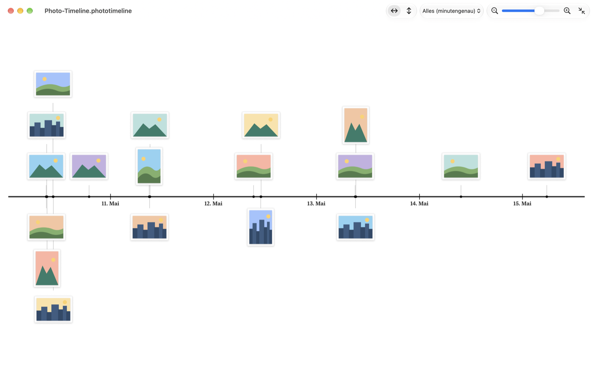

# Photo Timeline

A macOS app that lays your photos out on a timeline, spaced by when they were taken, and lets you fix wrong capture dates by dragging a photo to the right spot.



## Features

- **Drop photos or whole folders** into the window. Photos stay where they are on disk; a timeline document only remembers where they live.
- **Proportional timeline.** The distance between two photos matches the time between them. Photos taken close together stack in lanes above and below the axis, so they never cover each other, and a line to the axis marks each exact moment.
- **Horizontal or vertical**, zoom with the toolbar, the keyboard (⌘+ / ⌘− / ⌘0) or a pinch on the trackpad.
- **Preview:** click a photo to see it large; two photos can be compared side by side.
- **Change capture dates by dragging.** While you drag, a badge shows the new date. Choose how much of the date may change: only the year, month and year, the day, or everything to the minute.
- **Write in one go.** Date changes are kept in the timeline document and marked until you write them into the photos. Then the EXIF capture date and the file dates are updated for all changed photos at once. Undo writes the previous dates back.

## Download

Get the latest version from [Releases](https://github.com/dirkfabisch/PhotoTimeline/releases). Releases are signed with a Developer ID and notarized by Apple, so they open without warnings.

Requirements: macOS 26 or later on a Mac with Apple silicon.

> **Photo Timeline writes into your original files** when you choose "In Fotos schreiben…" (write to photos). It checks every file after writing and leaves it untouched if the result does not read back correctly, but please keep a backup of photos you care about.
>
> Writing is tested with JPEG, HEIC, PNG and TIFF. RAW formats such as DNG are not tested yet.

The user interface is currently in German. An English localization is the next planned feature.

## Privacy

The app runs in the macOS App Sandbox. It can only read and write the photos and folders you drop into it or pick in the Open panel, and it makes no network connections.

## Build it yourself

You need Xcode 26 or later.

```sh
git clone https://github.com/dirkfabisch/PhotoTimeline.git
cd PhotoTimeline
open PhotoTimeline.xcodeproj   # then press ⌘R
```

Or from the command line:

```sh
xcodebuild -scheme PhotoTimeline -configuration Release -derivedDataPath build build
open build/Build/Products/Release/PhotoTimeline.app
```

The project is set up to sign locally ("Sign to Run Locally"), so it builds without an Apple Developer account. Run the tests with:

```sh
xcodebuild test -scheme PhotoTimeline -destination 'platform=macOS'
```

## Publishing a release

For maintainers with a Developer ID certificate. Signing settings and notary credentials stay on your Mac and are never committed.

1. Copy `scripts/release.env.example` to `scripts/release.env` and enter your team ID.
2. Store notary credentials in your keychain once:
   ```sh
   xcrun notarytool store-credentials PhotoTimeline --apple-id <apple-id> --team-id <team-id>
   ```
3. Raise `MARKETING_VERSION` in the project, commit and push.
4. Run `scripts/release.sh --publish`. It builds, signs, notarizes, staples, checks the app with Gatekeeper, tags the version and uploads the zip as a GitHub release.

Without `--publish` the script only produces the notarized zip in `build/`.

## Project layout

| Folder | Contents |
|---|---|
| `PhotoTimeline/Model` | Timeline document, photo references, security-scoped bookmarks |
| `PhotoTimeline/Metadata` | Reading and writing capture dates with ImageIO |
| `PhotoTimeline/Timeline` | Timeline layout, axis, tiles, preview, empty state |
| `PhotoTimelineTests` | Unit tests (Swift Testing) |
| `Design/AppIcon` | Icon layers and earlier icon concepts for Icon Composer |
| `scripts` | Release script |

## License

[MIT](LICENSE) © 2026 Dirk Fabisch
